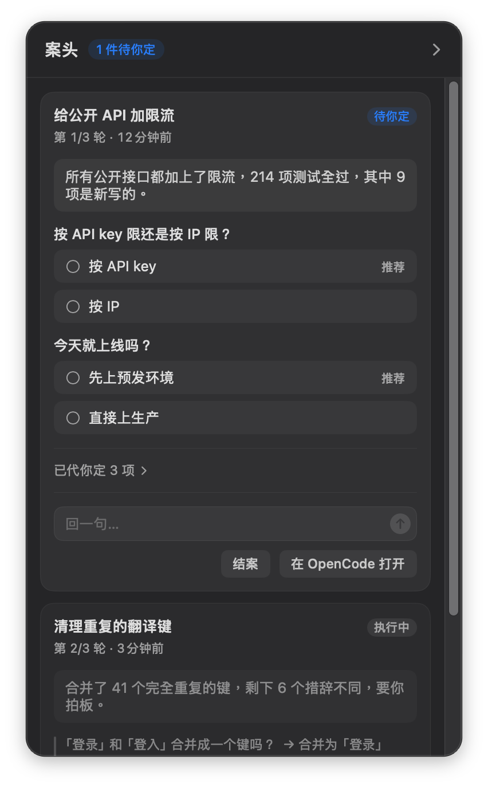

# OpenClaw Desk

**Hand coding work off from your OpenClaw chat. Decide on a quiet panel. Skip the transcripts.**

When your OpenClaw agent hands a task to a coding agent (OpenCode, Claude Code or Codex), the follow-up moves out of your chat and onto a native macOS panel. A project-manager agent follows the task, checks what was delivered, and brings you a one-sentence brief with at most two decisions, each with a recommended answer. You click, it relays, the work goes on.

<p align="center"></p>

## What you get

- **Your chat stays a chat.** Handing off gets one line back: "Handed off: Add rate limiting to the public API." No progress reports, no technical questions, nothing waiting for an answer in the middle of your day.
- **A PM for every handoff.** When the coding agent finishes a run, a dedicated agent reads the result, checks the delivery itself (opens the files, runs the unit tests), and decides the technical details on its own. Only what truly needs you reaches the panel.
- **Briefs you can answer in a second.** One sentence on where things stand. At most two questions, each with a recommended option. Everything the PM decided for you is listed, folded away, one click from view.
- **Three rounds, then it's yours.** Back-and-forth through the Desk is capped at three relayed decisions. After that, or whenever you like, one button opens the session in OpenCode, or in Terminal for Claude Code and Codex, and you take it from there.
- **It works from your words, not a paraphrase.** A judge model picks the messages from your chat that belong to the task and hands them to the PM verbatim. On 17 real handoffs it kept 97% of the relevant messages and all of the ones that stated requirements.
- **Calm by design.** The panel rests as a small pill on the screen edge (⌥⌘D to open). No notifications, no sounds. A brief can wait until you have a minute.
- **English and Chinese.** It follows the system language, including the briefs the PM writes.

## Why not just…

**…keep following up in the chat?** A chat is synchronous: a question you have not answered blocks the conversation, and every report lands between everything else you are doing. Your agent's habit of expanding on things is exactly wrong for a task you handed off so you would not have to think about the details. The Desk is asynchronous and terse on purpose.

**…open the session in OpenCode, or use an [inbox](https://github.com/PeberWang/opencode-openclaw-inbox)?** That means reading the coding agent's transcript and, in practice, steering technical details yourself. An inbox tells you a session exists; the Desk tells you what was decided and asks only what is left. The two fit together: start with the inbox if all you want is to see dispatched sessions and jump into them; the Desk is the same idea carried further, with a PM per handoff. They share the dispatch convention, and the Desk can be the only entry point.

**…let the agent run and check the result later?** You would get a long technical summary written by the agent that did the work. The Desk's PM is a second agent that verifies the delivery and turns it into a decision. Its output is checked in code: lengths, number of questions, exactly one recommended option.

**…tell the coding agent to write shorter summaries?** Shorter is not the problem; deciding what needs you is. The PM keeps a running record of what you said, what was decided and how many rounds are left, makes the technical calls itself, and lists them where you can check them.

## How it works

```
your chat ── OpenClaw ──(desk-dispatch: start and return)──▶ OpenCode · Claude Code · Codex
                │                                                │
                │ transcript (read-only)                         │ run ended (events or process exit)
                ▼                                                ▼
        ┌───────────────────────── Desk service (launchd) ─────────────────────────┐
        │ judge (Jev): your words that belong to the task; later mentions in chat   │
        │ ledger (SQLite): handoffs, briefs, decisions, rounds                      │
        │ PM: one OpenClaw session per handoff, woken only when a run ends          │
        │ relays your decision to the coding agent, counts rounds (max 3)           │
        └───────────────────────────────────────────────────────────────────────────┘
                                         ▲
                              Desk.app: menu bar + panel
```

- Code keeps watch, the model only judges: the PM is not a loop. It is woken once per finished run with `openclaw agent --session-key agent:main:desk-<id>`, and nothing it writes goes to your chat.
- When you close a handoff, a one-sentence conclusion goes into OpenClaw's daily memory, so your agent still knows what happened.
- If you mention a handoff in the chat later, the judge recognises it and the PM proposes a follow-up on the panel. It is never sent without your click.

The full rationale is in [docs/design.md](docs/design.md).

## Install

Requirements: macOS 14 or later, Command Line Tools (`xcode-select --install`), [OpenClaw](https://openclaw.ai), and at least one coding agent: [OpenCode](https://opencode.ai) Desktop with the [inbox plugin](https://github.com/PeberWang/opencode-openclaw-inbox) v0.4.0 or later (install it from the release or a checkout until 0.4.0 is on npm), or the [Claude Code](https://code.claude.com) / [Codex](https://developers.openai.com/codex) CLI, logged in.

```sh
git clone https://github.com/PeberWang/openclaw-desk.git
cd openclaw-desk
bash scripts/install.sh
```

The script builds the app into `~/Applications`, starts the service and the app as launch agents, and installs the `desk-dispatch` skill into OpenClaw. Then:

1. **Tell OpenClaw to hand off through the Desk.** Add to `~/.openclaw/workspace/AGENTS.md`:
   > Hand coding work off with the desk-dispatch skill. After dispatching, reply with one line and leave the follow-up to the Desk.
2. **Optional: the judge.** Get a key at [console.typesafe.ai](https://console.typesafe.ai) and put it in `TYPESAFE_API_KEY` or in `~/.openclaw/workspace/secrets.json` as `"typesafe": {"api_key": "…"}`. Without it, handoffs work, without picked background and chat mentions.

To remove it: `bash scripts/uninstall.sh` (add `--purge` to delete the data too).

## Use

- Ask OpenClaw to hand something off, as you normally would. It answers with one line.
- When a brief is ready, the pill on the right edge shows a count. Click it or press ⌥⌘D.
- Pick an option, or write one line, and send. **Mark done** closes the handoff; **Open in OpenCode** (or **Continue in Terminal**) hands the session to you.
- `desk-dispatch --engine claude` or `--engine codex` picks another coding agent for one task; `"engine"` in the config changes the default.

## Configure

`~/Library/Application Support/openclaw-desk/config.json` (restart the service after editing: `launchctl kickstart -k gui/$(id -u)/io.github.peberwang.openclaw-desk`):

| Key | Default | Meaning |
|---|---|---|
| `watch` | `["*"]` | OpenClaw sessions whose handoffs go to the Desk (`fnmatch` patterns), e.g. `["agent:main:main"]` |
| `locale` | `"auto"` | `"auto"` follows macOS; `"en"` or `"zh"` |
| `engine` | `"opencode"` | default coding agent: `opencode`, `claude` or `codex` |
| `pm_model` | `null` | model for the PM sessions; `null` uses your OpenClaw default |
| `attribute` | `true` | recognise later mentions of a handoff in the chat |
| `context_threshold` | `0.5` | how sure the judge must be to keep a message as background |
| `move_threshold` | `0.85` | how sure it must be that a chat message belongs to a handoff |
| `engines` | | per-agent CLI arguments, e.g. `{"claude": {"args": [...]}}` |

Nobody is there to approve prompts during a run. OpenCode gets `--auto` when `desk-dispatch --auto` is used; Claude Code runs with `--permission-mode acceptEdits`, an allow list and `--permission-prompts none`; Codex with `--sandbox workspace-write`. Change them under `engines`.

## Privacy

- The service listens on `127.0.0.1` only, with a random token per start.
- The judge sees only the sessions you watch, only the user and assistant text, and only a recent window. Credentials are stripped first (`judge/redact.py`). [TypeSafe's policy](https://typesafe.ai/legal/privacy-policy) says inputs are not used for training and not shared beyond its service providers.
- The PM runs through your own OpenClaw, so its prompts go to whichever model your OpenClaw uses.

## Status

Early, and used daily by its author with OpenCode. Known limits:

- macOS only. The transcript reader targets OpenClaw 2026.9.x.
- The Claude Code path is tested end to end; the Codex path follows the official CLI docs but has not been run yet. Reports welcome.
- The round limit is fixed at 3. The panel docks to the main screen.

Development notes: offline tests with `python3 -I -m unittest discover -s tests -p 'test_*.py'`; a fake service for UI work in `app/dev-daemon.py`; the judge's evaluation harness in `eval/` (it needs your own data, which never leaves `eval/data/`).

## 中文说明

OpenClaw 的聊天主线里交办出去的编程任务，挪到桌面上的原生面板「案头」里推进：每件交办有一个项目经理 agent 跟进，OpenCode（或 Claude Code、Codex）每做完一轮，它自己核实交付，写成一句话进展加最多两个待你定的问题，每个问题给出推荐选项。你点一下或回一句，它转给编程代理续做。聊天里只留一句「已交办」，不再被进度和技术细节打断；往返满 3 轮，或者你想自己动手时，一键在 OpenCode 或终端接管。判断器（TypeSafe Jev）会从聊天里挑出你关于这件事的原话交给项目经理，不靠转述。界面和请示件跟随系统语言，可在配置里设 `"locale": "zh"`。安装：`bash scripts/install.sh`。

<p align="center"></p>

## License

MIT
