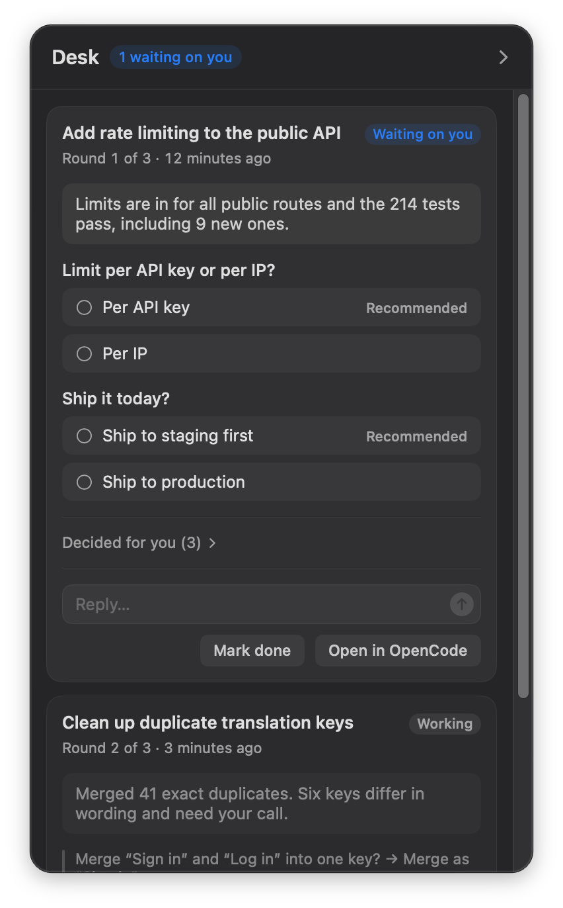

# OpenClaw Docket

*A panel between your OpenClaw chat and the coding agent, for the decisions that can wait.*

A chat is synchronous: one question you have not answered holds up the whole conversation. A coding agent (OpenCode, Claude Code or Codex) is parallel: handed-off tasks move forward in the background, each on its own. Between the two there is no layer where a judgment can pause, pile up and arrive late. OpenClaw Docket is that layer, a native macOS panel. Everything that needs you, but not now, lands there.

## Five-minute quick start

You need macOS 14+, `xcode-select --install`, a working [OpenClaw](https://openclaw.ai), and one coding agent CLI (here Claude Code, logged in).

```sh
git clone https://github.com/PeberWang/docket.git && cd docket
bash scripts/install.sh          # builds Docket.app, starts the service and the app
```

1. A tray icon appears in the menu bar and a pill on the right screen edge (⌥⌘D opens the panel).
2. Add one line to `~/.openclaw/workspace/AGENTS.md`:
   `Hand coding work off with the desk-dispatch skill, reply with one line, and leave the rest to Docket.`
3. In your OpenClaw chat: "Hand off to Claude Code: add a README section on testing to ~/my-project."
   Or straight from a shell: `cd ~/my-project && ~/.openclaw/workspace/skills/desk-dispatch/scripts/desk-dispatch --engine claude --title "Testing docs" "Add a README section on testing"`
4. A card for the handoff shows up on the panel at once; when the run ends, the PM's brief replaces it.

No judge key is needed to get here. Without one, Settings → Models shows the judge as not configured and cards arrive without picked background.

<p align="center"></p>

## Three rhythms

Each kind of work keeps its own pace: the chat answers at once, the coding agent works in parallel, and the decisions wait on Docket until you get to them.

### The chat: synchronous

You and your agent take turns, so the chat only stays a chat if handed-off work does not come back into it. Handing off gets one line back: "Handed off: Add rate limiting to the public API." No progress reports, no technical questions, nothing waiting for an answer in the middle of your day.

What you said still reaches the work in your own words, not a paraphrase. A judge model picks the messages from your chat that belong to the task and hands them to the PM verbatim. On 17 real handoffs it kept 97% of the relevant messages and all of the ones that stated requirements.

### The coding agent: parallel

Each handoff runs in the background in its own coding-agent session, and each one has its own project-manager agent. When the coding agent finishes a run, the PM reads the result, checks the delivery itself (opens the files, runs the unit tests) and decides the technical details on its own. Only what truly needs you reaches the panel.

Back-and-forth through Docket is capped at three relayed decisions. After that, or whenever you like, one button opens the session in OpenCode, or in Terminal for Claude Code and Codex, and you take it from there.

### Docket: it can be late

A brief arrives when the work reaches a decision and waits until you have a minute. The panel rests as a small pill on the screen edge (⌥⌘D to open), with no notifications and no sounds.

A brief is answered in a second: one sentence on where things stand, at most two questions, each with a recommended option. Everything the PM decided for you is listed, folded away, one click from view. You click or write one line, the PM relays it, and the work goes on. The panel follows the system language, English or Chinese, and so do the briefs the PM writes.

## Simpler alternatives

### Just keep following up in the chat

A chat is synchronous: a question you have not answered blocks the conversation, and every report lands between everything else you are doing. Your agent's habit of expanding on things is exactly wrong for a task you handed off so you would not have to think about the details. Docket is asynchronous and terse on purpose.

### Just open the session in OpenCode, or use an [inbox](https://github.com/PeberWang/opencode-openclaw-inbox)

That means reading the coding agent's transcript and, in practice, steering technical details yourself. An inbox tells you a session exists; Docket tells you what was decided and asks only what is left. The two fit together: start with the inbox if all you want is to see dispatched sessions and jump into them; Docket is the same idea carried further, with a PM per handoff. They share the dispatch convention, and Docket can be the only entry point.

### Just let the agent run and check the result later

You would get a long technical summary written by the agent that did the work. Docket's PM is a second agent that verifies the delivery and turns it into a decision. Its output is checked in code: lengths, number of questions, exactly one recommended option.

### Just tell the coding agent to write shorter summaries

Shorter is not the problem; deciding what needs you is. The PM keeps a running record of what you said, what was decided and how many rounds are left, makes the technical calls itself, and lists them where you can check them.

## Architecture

```
your chat ── OpenClaw ──(desk-dispatch: start and return)──▶ OpenCode · Claude Code · Codex
                │                                                │
                │ transcript (read-only)                         │ run ended (events or process exit)
                ▼                                                ▼
        ┌──────────────────────── Docket service (launchd) ────────────────────────┐
        │ judge (Jev): your words that belong to the task; later mentions in chat   │
        │ ledger (SQLite): handoffs, briefs, decisions, rounds                      │
        │ PM: one OpenClaw session per handoff, woken only when a run ends          │
        │ relays your decision; each time you take part is one round (max 3)        │
        └───────────────────────────────────────────────────────────────────────────┘
                                         ▲
                             Docket.app: menu bar + panel
```

- Code keeps watch, the model only judges: the PM is not a loop. It is woken once per finished run with `openclaw agent --session-key agent:main:docket-<id>`, and nothing it writes goes to your chat.
- When you close a handoff, a one-sentence conclusion goes into OpenClaw's daily memory, so your agent still knows what happened.
- If you mention a handoff in the chat later, the judge recognises it and the PM proposes a follow-up on the panel. It is never sent without your click.
- One writer: only the service hands instructions to the coding agent and wakes a PM, and only what a PM answers to the service is carried out. Anyone else (you, the main chat, another session) passes a word on with `docket note <handoff> "<text>"` or **Pass a word on** on the card.
- A watchdog in the service follows every instruction it hands over, every 30 s. The dispatch printing "dispatched" does not count: an instruction is running once its message is in the session and the session is busy. Not there within 90 s, or silent (no message, no file changed in the project) for 10 minutes, or ended interrupted, killed or failed: it is sent again once, in a new session told which files the last turn left when the old one is interrupted or stuck. A second miss marks the handoff stalled, with a card that says why and a retry. A PM answer that reached the PM some other way (a `sessions_send` into its session) is found within 2 minutes and carried out the service's way, or put on such a card. Each handoff's phase (`awaiting_dispatch`, `dispatching`, `running`, `awaiting_user`, `verifying`, `closed`, `stalled`) is in the ledger; `docket status <handoff>` prints it with every change, and a daily summary of how often work got stuck, healed itself or needed you goes to `~/.openclaw/workspace/cron-logs/docket/<date>/health.md`.

The full rationale is in [docs/design.md](docs/design.md).

## Installation

### Dependencies

- **Required:** macOS 14 or later and Command Line Tools (`xcode-select --install`, which brings Swift and `/usr/bin/python3`). Docket uses only the Python standard library and has no Swift packages.
- **Required:** [OpenClaw](https://openclaw.ai), with `openclaw` on your `PATH`. Docket reads its transcripts (read-only) and runs the PM through `openclaw agent`, so the PM uses whichever model and credentials your OpenClaw has.
- **Required, at least one coding agent:** [OpenCode](https://opencode.ai) Desktop with the [inbox plugin](https://github.com/PeberWang/opencode-openclaw-inbox) v0.4.0 or later, or the [Claude Code](https://code.claude.com) / [Codex](https://developers.openai.com/codex) CLI, logged in.
- **Optional, the judge:** a [TypeSafe](https://console.typesafe.ai) key for System One, or any OpenAI-compatible language-model endpoint with its model name and key. Without either, the judge is off: cards still register, without picked background or chat attribution.

### Install

```sh
git clone https://github.com/PeberWang/docket.git
cd docket
bash scripts/install.sh
```

The script builds the app into `~/Applications`, starts the service and the app as launch agents, and installs the `desk-dispatch` skill into OpenClaw. Then:

1. **Tell OpenClaw to hand off through Docket.** Add to `~/.openclaw/workspace/AGENTS.md`:
   > Hand coding work off with the desk-dispatch skill. After dispatching, reply with one line and leave the follow-up to Docket.
2. **Optional: the judge.** Settings → Models shows it as not configured until you take one of two ways: save a TypeSafe key there (it goes to the keychain; `TYPESAFE_API_KEY` or `"typesafe": {"api_key": "…"}` in `~/.openclaw/workspace/secrets.json` also work), or switch the backend to an OpenAI-compatible language model and fill in its endpoint, model and key. Without it, handoffs work, without picked background and chat mentions.

To remove it: `bash scripts/uninstall.sh` takes out the launch agents, the app, the skill and the settings, and prints where your handoff history is kept; add `--purge` to delete that too.

## Daily use

- Ask OpenClaw to hand something off, as you normally would. It answers with one line.
- When a brief is ready, the pill on the right edge shows a count. Click it or press ⌥⌘D.
- Pick an option, or write one line, and send. **Mark done** closes the handoff; **Open in OpenCode** (or **Continue in Terminal**) hands the session to you.
- Cards wait their turn. If a new brief arrives while a card is waiting, it queues behind it (the card shows "N more waiting") and nothing is overwritten. Answered cards drop out; a closed handoff shows only its conclusion.
- A permission request is the one thing that blocks the work. It never joins the card queue and there is no permission card on the panel: it appears only as a popup at the top right of the screen, which says in one sentence what the coding agent wants to do outside the project and what the risk is, for example "It wants to delete some temporary files outside the project; deleted files cannot be recovered.", and lets you allow or reject it. If the popup is not installed, the panel says so once, and you answer in the OpenCode window. If the run ends before you answer, the request expires by itself.
- `desk-dispatch --engine claude` or `--engine codex` picks another coding agent for one task; `"engine"` in the config changes the default.
- To add something to a handoff from anywhere but the panel, use `scripts/docket note <handoff> "<text>"` (a unique prefix of the id is enough; `scripts/docket list` shows them). `scripts/docket status <handoff>` shows where it stands. A card marked **Stuck** or **Docket fault** is the service saying it could not go on by itself: **Retry** sends the same thing again.

## Configuration

`~/Library/Application Support/docket/config.json` (restart the service after editing: `launchctl kickstart -k gui/$(id -u)/io.github.peberwang.docket`):

| Key | Default | Meaning |
|---|---|---|
| `watch` | `["*"]` | OpenClaw sessions whose handoffs go to Docket (`fnmatch` patterns), e.g. `["agent:main:main"]` |
| `locale` | `"auto"` | `"auto"` follows macOS; `"en"` or `"zh"` |
| `engine` | `"opencode"` | default coding agent: `opencode`, `claude` or `codex` |
| `pm_model` | `null` | model for the PM sessions; `null` uses your OpenClaw default |
| `pm_fallback_model` | `null` | model for a third try when the PM's reply failed twice; `null` = `pm_model` again |
| `fallback_model` | `null` | OpenCode model (`provider/model`) to retry a run once with after a usage limit; `null` = no retry |
| `prefix` | `""` | a title prefix your dispatcher puts on OpenCode sessions. `""` matches by title alone, and still accepts a symbols-only marker such as the inbox plugin's default emoji; a prefix with letters, like `"[oc] "`, has to be set here |
| `reconcile_max_age_hours` | `6` | on restart, a pending handoff idle longer than this is closed as overdue instead of woken |
| `awaiting_stale_after_minutes` | `30` | an awaiting card whose OpenCode session has ended is closed as expired after this many minutes with no reply |
| `stale_enabled` | `true` | look after cards nobody answers on the panel (the next three keys); `false` turns all of it off |
| `stale_threshold` | `0.9` | how sure the judge must be that you answered a card in the chat, or made it moot, before its PM closes it or relays your answer (needs the judge and `attribute`) |
| `quiet_wake_minutes` | `180` | a card unanswered this long, with the coding agent idle, wakes its PM once: it closes the card or asks one more specific question, never picks an option for you |
| `quiet_expire_minutes` | `1440` | a card unanswered this long is closed by Docket itself and noted as expired; both clocks start when the card goes up on the panel (not when a queued card was written), move on when the judge sees you still weighing it in the chat, and never before the first sweep with `stale_enabled` on |
| `judge` | `{}` | `backend` (`"systemone"` or `"openai"`), `model`, `endpoint`, `keychain_service`; easier from Settings → Models |
| `attribute` | `true` | recognise later mentions of a handoff in the chat |
| `context_threshold` | `0.5` | how sure the judge must be to keep a message as background |
| `move_threshold` | `0.85` | how sure it must be that a chat message belongs to a handoff |
| `engines` | | per-agent CLI arguments, e.g. `{"claude": {"args": [...]}}` |

A value of the wrong type (say, a string where a number belongs) is logged and replaced by its default; it does not stop the service.

Nobody is there to approve prompts during a run. OpenCode gets `--auto` when `desk-dispatch --auto` is used; Claude Code runs with `--permission-mode acceptEdits`, an allow list and `--permission-prompts none`; Codex with `--sandbox workspace-write`. Change them under `engines`.

## Privacy

- The service listens on `127.0.0.1` only, with a random token per start.
- The judge sees only the sessions you watch, only the user and assistant text, and only a recent window. Credentials are stripped first (`judge/redact.py`). [TypeSafe's policy](https://typesafe.ai/legal/privacy-policy) says inputs are not used for training and not shared beyond its service providers.
- The PM runs through your own OpenClaw, so its prompts go to whichever model your OpenClaw uses.

## Status

Early, and used daily by its author with OpenCode. Known limits:

- macOS only. The transcript reader reads OpenClaw 2026.9.x and 2026.11.x; it finds the agent database through `agent_databases` in `~/.openclaw/state/openclaw.sqlite`, falling back to the 2026.9 path. After upgrading OpenClaw, run `/usr/bin/python3 -I scripts/selfcheck.py`: its first line names the database it reads, whether the main session reads, and what became of the latest dispatch.
- The Claude Code path is tested end to end; the Codex path follows the official CLI docs but has not been run yet. Reports welcome.
- The round limit is fixed at 3. The panel docks to the main screen.

Development notes: offline tests with `python3 -I -m unittest discover -s tests -p 'test_*.py'`; `bash app/build.sh` builds the app (with Command Line Tools only, `ld` warns that two search paths under `/Library/Developer/CommandLineTools/Developer` are not found; that is harmless and the only expected warning); a fake service for UI work in `app/dev-daemon.py`; the judge's evaluation harness in `eval/` (it needs your own data, which never leaves `eval/data/`).

## 中文说明

*夹在 OpenClaw 聊天和编程代理之间的一块面板，放那些可以晚一点再定的事。*

聊天是同步的：一个没回答的问题会卡住整条对话。编程代理（OpenCode、Claude Code 或 Codex）是并行的：交办出去的任务在后台各自推进。两者之间缺一层可以停、可以攒、可以迟到的判断缓冲，「案头」就是这一层，一块 macOS 原生面板。所有「需要你，但不是现在」的事都落在这里。

<p align="center"></p>

### 聊天：同步

聊天里只留一句「已交办」，不追问、不汇报进度，不再被技术细节打断。判断器（TypeSafe Jev）会从聊天里挑出你关于这件事的原话交给项目经理，不靠转述。

### 编程代理：并行

每件交办在后台有自己的编程代理会话，也有自己的项目经理 agent。OpenCode（或 Claude Code、Codex）每做完一轮，项目经理自己核实交付，替你定技术细节，只把真正需要你的事送上面板。往返满 3 轮，或者你想自己动手时，一键在 OpenCode 或终端接管。

### 案头：可以迟到

请示件是一句话进展加最多两个待你定的问题，每个问题给出推荐选项，可以等到你有空再看。你点一下或回一句，项目经理转给编程代理续做。界面和请示件跟随系统语言，可在配置里设 `"locale": "zh"`。

只有案头的后台能给编程代理派活、能叫醒项目经理。别处想补一句话（你、主会话、别的会话），用 `docket note <交办> "<话>"` 或卡片上的「转达一句」。后台每 30 秒看一眼每条派出去的指令：90 秒内没在会话里出现、跑着跑着 10 分钟没有新消息也没改文件、或者中断退出，都自动重派一次，第二次还不动就标成「卡住了」并出卡附重试。`docket status <交办>` 能看到每一次状态跃迁，每天的健康摘要写在 `~/.openclaw/workspace/cron-logs/docket/<日期>/health.md`。

安装：`bash scripts/install.sh`；卸载：`bash scripts/uninstall.sh`（保留交办记录，加 `--purge` 一并删除）。没有判断模型的密钥也能用，设置窗口会显示「未配置」。

## License

MIT
